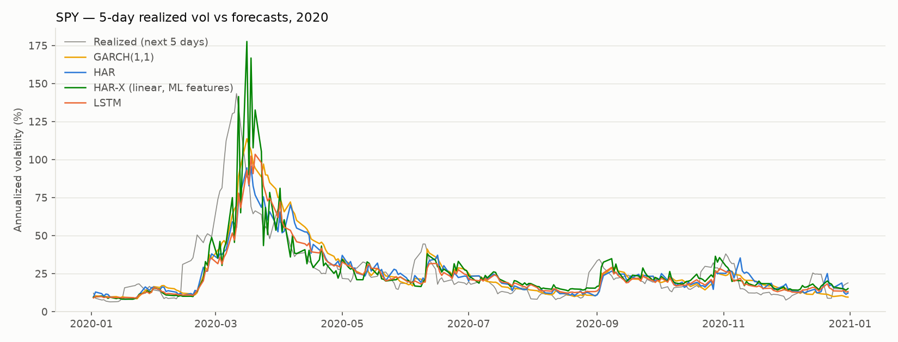
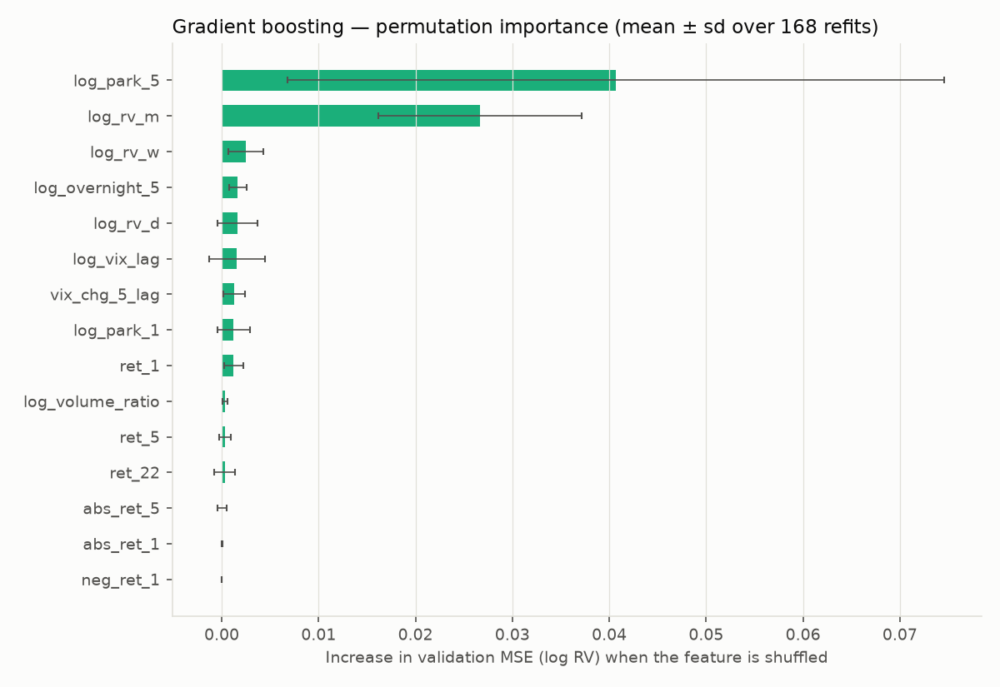
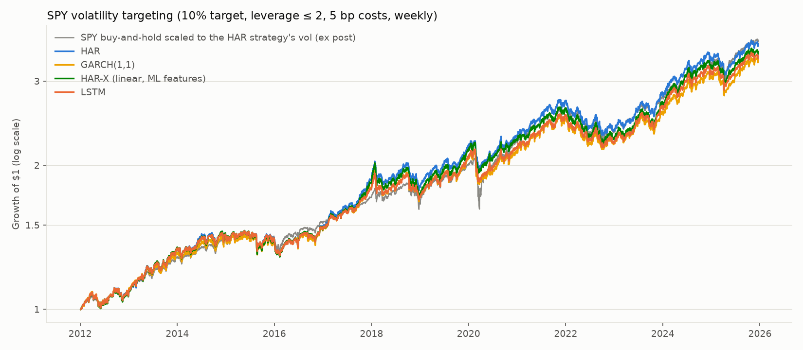

# Machine Learning for Volatility Forecasting

Forecasting the **5-day realized volatility** of S&P 500 stocks with econometric and
machine-learning models, evaluated in a strict walk-forward setting (2012–2025), and
tested economically in a volatility-targeting strategy on SPY.

## Key findings

1. **Machine learning beats the HAR benchmark, but a linear model with the same
   features does as well.** On QLIKE, the LSTM is 5.8% better than HAR (Diebold-Mariano
   p < 0.001) and gradient boosting 2.4% better (p = 0.069, not significant at 5%). However, a
   **linear HAR-X model estimated per stock on the same 15 predictors is the most accurate
   model (−7.0% vs HAR, better on 23/23 stocks)**, and the LSTM is statistically
   indistinguishable from it (p = 0.19). The gains come from the **extra information**
   (range-based Parkinson volatility, VIX, overnight variance), not from non-linearity.
2. **GARCH-type models lose to HAR by 11–12% on QLIKE** (significant), as the literature
   usually finds at multi-day horizons with range-based information.
3. **On MSE, almost no difference is significant**: squared errors on variance are
   dominated by a handful of crisis days.
4. **Better forecasts do not make a better strategy.** No volatility-targeting strategy
   beats SPY buy-and-hold on Sharpe ratio over 2012–2025 (0.74–0.80 vs 0.82, standard error
   ≈ 0.31). Volatility targeting does cut the maximum drawdown (about −15% vs −21% for
   buy-and-hold scaled to the same volatility). The most accurate forecasts (HAR-X, LSTM)
   do not give the best Sharpe ratio.

These are negative or mixed results for the "ML vs econometrics" question, reported as
they came out. No hyperparameter was tuned on the test period.

## Data and target

- **Source**: daily OHLCV from Yahoo Finance (`yfinance`), 2005-01-03 to 2025-12-31,
  split- and dividend-adjusted, cached locally in parquet (not versioned).
- **Universe**: SPY + 22 large S&P 500 stocks from 9 sectors (AAPL, MSFT, INTC, CSCO, GOOGL,
  AMZN, HD, MCD, PG, KO, WMT, JPM, BAC, GS, XOM, CVX, JNJ, PFE, UNH, CAT, BA, NEE).
  **Survivorship bias**: these are today's survivors, chosen with hindsight; stocks that
  were delisted or dropped from the index are absent, which likely makes the universe
  calmer than a point-in-time one.
- **Exogenous variable**: VIX close, always **lagged by one day** (it closes after the
  stock market).
- **Daily variance proxy**: Garman-Klass range estimator **plus the squared overnight
  return**:

  `v_t = ln(O_t/C_{t-1})² + ½ ln(H_t/L_t)² − (2 ln 2 − 1) ln(C_t/O_t)²`

  The overnight term is needed: it accounts for **23% (NEE) to 40% (GOOGL) of total
  variance** (35% for SPY). Without it the target would be biased downwards, and
  close-to-close models such as GARCH would be penalized by construction.
- **Target**: `RV_t = sqrt(252/5 · Σ_{i=1..5} v_{t+i})`. Models predict `ln RV_t`.
  This is a **proxy**: true realized volatility requires intraday data (e.g. 5-minute
  returns). QLIKE and MSE are robust to proxy noise for *ranking* models (Patton, 2011).

## Models

| Model | Description | Estimation |
|---|---|---|
| Naive | realized vol of the last 5 days | — |
| HAR-RV (Corsi, 2009) | OLS of ln RV on ln rv_d, ln rv_w, ln rv_m (1, 5, 22 days) | per stock, refit every 21 days |
| GARCH(1,1), GJR-GARCH(1,1) | Student-t innovations, close-to-close returns, 5-step variance forecast summed | per stock, refit every 21 days, variance filtered daily between refits |
| HAR-X | OLS of ln RV on the 15 ML predictors (control) | per stock (main) and pooled (ablation), refit every 21 days |
| Gradient boosting | scikit-learn `HistGradientBoostingRegressor` on 15 predictors | pooled across stocks, refit every 21 days |
| LSTM | 1 layer × 32 units, sequences of 22 days of the 15 predictors, average of 3 seeds | pooled across stocks, refit yearly |

**Predictors (ML and HAR-X)**: ln rv over 1/5/22 days; return of the day and mean over 5/22
days; |return| of the day and over 5 days; negative part of the return; ln Parkinson vol over
1 and 5 days; ln VIX(t−1) and its 5-day change; ln(volume / 22-day mean); ln overnight vol over
5 days.

**Back to the variance scale**: if `ln RV = m + ε`, `ε ~ N(0, s²)`, then
`E[RV²] = exp(2m + 2s²)`. Without this correction, `exp(2m)` is biased downwards (Jensen),
which QLIKE punishes heavily. `s²` comes from the training residuals (OLS) or from the
held-out validation year (GBM, LSTM), whose in-sample residuals are too optimistic.

## Validation protocol (no information leakage)

- **Expanding-window walk-forward**: at refit date T the model is trained on all data from
  2005 to T and forecasts the next block. Data are never shuffled across time. First test
  date: 2012-01-03.
- **Purging**: training samples are limited to dates `t ≤ T − 5`, so every training target
  (`t+1 … t+5`) is fully observed at T.
- **Early stopping without leakage**: scikit-learn's built-in early stopping draws a
  *random* validation set, which would leak through overlapping targets. Instead, the last
  252 days of each training window are a validation set, purged by 5 days. The GBM is then
  refitted on the whole window with the selected number of trees; the LSTM keeps its best
  epoch.
- **Scalers** (LSTM) are fitted on the training part only, at every refit.
- **Hyperparameters** were chosen **once** on a pre-test split (train 2005–2008, validate
  2009–2011), then frozen in `configs/default.yaml`. The grids are small and flat (GBM
  validation QLIKE 0.257–0.274, LSTM 0.318–0.330), so this choice matters little.
- **Automated tests** (60 pytest tests) check, by perturbing the data, that features at t
  only use data up to t, that the target at t only uses t+1 … t+5, that VIX enters with a
  one-day lag, that GARCH forecasts and LSTM training ignore the future, that splits are
  purged, and that the backtest takes positions after the forecast is known. On the real
  data, re-running an LSTM refit with all post-training targets erased gives bit-identical
  forecasts.

## Evaluation

- **Losses** (on the variance scale): QLIKE (main), MSE of variance, MAE of volatility,
  Mincer-Zarnowitz regression `RV² = α + β F` (α, β, R²).
- **Common sample**: 80,845 forecasts (23 stocks × 2012-01-03 … 2025-12-23) where every
  model has a forecast; metrics are computed per stock, then averaged.
- **Diebold-Mariano** tests with Newey-West (Bartlett) variance and the
  Harvey-Leybourne-Newbold correction. The universe-level test uses the cross-sectional
  average loss differential per day, which accounts for the strong correlation between
  stocks.
  *Bandwidth*: the textbook rule `4(n/100)^{2/9}` (≈ 8 lags) **over-rejected a true null
  20–30% of the time** in simulations that reproduce overlapping 5-day targets and volatility
  clustering. The bandwidth `√n` (≈ 59 lags) keeps the size close to 5–8% and is used
  throughout (see `tests/test_evaluation.py`). With ≈ 250 days (one-year regimes), no
  bandwidth is reliable and those p-values are indicative only.

## Results

### Forecast accuracy (2012–2025, averaged over 23 stocks)

| Model | QLIKE | vs HAR | MSE (var.) | MAE (vol) | MZ β | MZ R² | Stocks beating HAR (QLIKE) |
|---|---|---|---|---|---|---|---|
| **HAR-X (per stock)** | **0.258** | **−7.0%** | 0.022 | 0.061 | 0.94 | 0.31 | 23/23 |
| LSTM | 0.261 | −5.8% | 0.021 | **0.059** | 1.03 | **0.32** | 19/23 |
| Gradient boosting | 0.271 | −2.4% | **0.020** | 0.062 | 0.92 | 0.31 | 19/23 |
| HAR | 0.277 | — | 0.022 | 0.066 | 1.22 | 0.28 | — |
| GJR-GARCH | 0.309 | +11.3% | 0.021 | 0.069 | 0.82 | 0.28 | 1/23 |
| GARCH(1,1) | 0.310 | +11.9% | 0.022 | 0.070 | 0.84 | 0.25 | 1/23 |
| Naive | 0.392 | +41.2% | 0.027 | 0.070 | 0.52 | 0.29 | 0/23 |

### Diebold-Mariano tests on QLIKE

Universe-level p-value; in brackets, the number of stocks where the model is
significantly better (+) / worse (−) at 5%. With 23 stocks, about one rejection per row is
expected by chance.

| Model | vs GARCH | vs HAR | vs HAR-X |
|---|---|---|---|
| HAR-X | p < 0.001 (21+ / 0−) | p < 0.001 (15+ / 0−) | — |
| LSTM | p < 0.001 (18+ / 0−) | p < 0.001 (13+ / 0−) | p = 0.185 (2+ / 2−) |
| Gradient boosting | p < 0.001 (17+ / 0−) | p = 0.069 (7+ / 0−) | p < 0.001 (0+ / 11−) |
| HAR | p < 0.001 (15+ / 0−) | — | p < 0.001 (0+ / 15−) |
| GJR-GARCH | p = 0.595 (2+ / 1−) | p < 0.001 (0+ / 10−) | p < 0.001 (0+ / 19−) |

On MSE, apart from the naive model (worse than HAR, p = 0.04), no model differs
significantly from HAR or HAR-X at the universe level (all p > 0.25; full table in
`reports/tables/results.md`).

### Ablations: where do the gains come from?

| Variant | QLIKE vs HAR | Reading |
|---|---|---|
| HAR pooled across stocks | +2.4% | pooling alone hurts a linear model |
| GBM on the 3 HAR features only | +1.9% | trees approximate the near-linear HAR relation poorly |
| HAR-X pooled (15 features) | −1.9% | features help, even pooled |
| GBM (15 features, pooled) | −2.4% | ≈ pooled linear model with the same features |
| LSTM (15 features, pooled) | −5.8% | best pooled model |
| HAR-X per stock (15 features) | −7.0% | best overall |

### By market regime (QLIKE ratio to HAR; universe DM p-value)

| Model | 2015–2019 (calm) | 2020 (Covid) | 2022 (inflation) |
|---|---|---|---|
| HAR-X | 0.944 (p < 0.001) | 0.874 (p = 0.19) | 0.853 (p < 0.001) |
| LSTM | 0.955 (p = 0.046) | 0.881 (p = 0.29) | 0.847 (p = 0.001) |
| Gradient boosting | 0.985 (p = 0.41) | 0.900 (p = 0.28) | 0.917 (p = 0.007) |
| GARCH(1,1) | 1.136 (p < 0.001) | 1.164 (p < 0.001) | 1.226 (p = 0.001) |

The feature-rich models gain most in stressed regimes (−12% to −15%), but one year of data
is too short for the 2020 gains to be significant.

### Figures


*Cumulative loss difference relative to HAR: lines going down accumulate a lower loss.
The HAR-X and LSTM gains are steady over time, with a jump in March 2020; GARCH loses
steadily.*



*All models react to the Covid shock with a lag of a few days. The linear HAR-X overshoots
on some days (up to ≈ 175%): a linear model extrapolates when predictors leave their usual
range. QLIKE punishes over-prediction much less than under-prediction.*




*Permutation importance on each refit's validation year. The 5-day Parkinson volatility and
the monthly realized volatility dominate. Correlated predictors (Parkinson 5 days and
rv_w) share their importance, so a low score does not mean a useless variable.*

## Volatility-targeting backtest (SPY)

- Weight `w = min(10% / forecast vol, 2)`, decided on the last trading day of each week from
  the **previous day's** forecast, set at that day's close, then left to drift with prices.
- SPY total return; uninvested cash earns, and leverage is financed at, the previous day's
  13-week T-bill rate (`^IRX`). Costs: 5 bp per unit of turnover.
- Benchmark: buy-and-hold **scaled ex post to each strategy's realized volatility**
  (constant weight, same weekly rebalancing and costs). This uses hindsight; it is a
  reference, not a tradable strategy.
- Period: 2012-01-06 to 2025-12-19.

| Strategy | Return | Vol | Sharpe (± s.e.) | Max DD | Turnover / yr | Scaled B&H return | Scaled B&H max DD |
|---|---|---|---|---|---|---|---|
| SPY buy-and-hold | 14.8% | 16.7% | 0.82 (± 0.31) | −33.7% | — | — | — |
| HAR | 9.6% | 10.2% | 0.80 (± 0.31) | −15.6% | 6.7 | 9.8% | −21.7% |
| LSTM | 9.2% | 9.7% | 0.79 (± 0.31) | −14.8% | 4.4 | 9.4% | −20.7% |
| HAR-X | 9.3% | 10.2% | 0.78 (± 0.31) | −15.9% | 6.5 | 9.7% | −21.7% |
| Gradient boosting | 8.6% | 9.3% | 0.77 (± 0.30) | −14.6% | 5.6 | 9.1% | −20.0% |
| GARCH(1,1) | 9.0% | 10.0% | 0.76 (± 0.30) | −14.9% | 5.1 | 9.6% | −21.4% |
| GJR-GARCH | 8.9% | 10.4% | 0.72 (± 0.30) | −15.4% | 6.9 | 9.9% | −22.1% |
| Naive | 9.9% | 11.7% | 0.74 (± 0.30) | −18.4% | 13.0 | 10.9% | −24.6% |



**Reading.**
- Every strategy lands close to its 10% volatility target (9.3–10.4%; naive 11.7%),
  so the forecasts are well calibrated for risk control.
- **No strategy improves the Sharpe ratio** over buy-and-hold (0.82). The gaps (≤ 0.08)
  are a quarter of one standard error. Each strategy also earns slightly less than
  buy-and-hold scaled to the same volatility.
- Volatility targeting **reduces the maximum drawdown** by about 6 points against scaled
  buy-and-hold. The scaled buy-and-hold's worst loss is the Covid crash (−21.7%,
  Feb–Mar 2020). The HAR strategy had cut its weight from 0.81 to 0.30 by the end of
  February 2020 and avoided most of it. Its own worst drawdown (−15.6%) is the slow 2022 bear
  market, where volatility never spiked enough to de-lever much.
- Volatility spikes were often followed by fast rebounds (2020, 2025), which a de-levered
  portfolio partly misses. This offsets the benefit of avoiding the crashes.
- **Forecast accuracy does not rank the strategies**: HAR has the best Sharpe ratio, but
  is the least accurate of the four HAR-type and ML models. The LSTM has the lowest turnover
  (4.4 per year), a practical advantage that the Sharpe ratio does not show.
- An "oracle" that knows next week's realized volatility reaches a Sharpe ratio of 1.93
  (`reports/tables/backtest.csv`). This is **not** the value of a perfect forecast:
  high-volatility weeks are mostly down weeks, so knowing future volatility partly means
  knowing future returns.

## Limitations

- **Volatility proxy** from daily OHLC, not intraday data. Garman-Klass assumes continuous
  prices with no drift; discrete trading and bid-ask bounce bias the range.
- **Survivorship bias** in the universe (see above). The results apply to large, liquid,
  surviving stocks.
- **Scheduled jumps are not modeled.** Earnings announcements produce large overnight
  moves. Three of the four stocks where every model struggles most (AMZN, INTC, CSCO) are
  among those with the largest overnight share of variance (39–40%); WMT, the fourth, is
  not (31%). An earnings calendar would likely help but is not available reliably from
  `yfinance`.
- **Pooling.** The pooled GBM and LSTM have no stock identifier and do worse than HAR on
  the four big tech stocks (AAPL, GOOGL, INTC, AMZN for the GBM).
- **Model selection.** The HAR-X controls were specified after the GBM and LSTM results
  were known, but before being run, and they were not tuned. They turned out to be the
  strongest model, which is reported as such.
- **LSTM validation vs test.** On the 2009–2011 tuning split the LSTM was clearly worse
  than the GBM (QLIKE 0.318 vs 0.257), but it was better on the test. Its training set
  there was small (≈ 20k sequences vs up to ≈ 100k in the last walk-forward refits). The reversal was checked for
  leakage (see above) but not tuned away.
- **Statistical caveats.** Many DM tests are run (multiple testing), the regime-level
  p-values rest on ≈ 250 days, and Sharpe ratio differences over 14 years cannot be told
  apart.
- **Backtest simplifications.** Single asset, borrowing at the T-bill rate, linear costs,
  no market impact, no margin constraints. The scaled buy-and-hold benchmark uses hindsight.
- **Data**: `yfinance` is unofficial; adjusted prices can be revised by Yahoo.

## Project summary (CV)

- Built an end-to-end walk-forward pipeline (Python, scikit-learn, PyTorch, `arch`) to
  forecast the 5-day realized volatility of 23 S&P 500 stocks over 2012–2025, comparing
  HAR, GARCH, gradient boosting and LSTM models with purged validation, 60 leakage and
  correctness tests, and Diebold-Mariano inference.
- Found that an LSTM reduced the QLIKE loss by 5.8% vs the HAR benchmark (p < 0.001), but a
  linear model on the same predictors did as well (−7.0%). In a SPY volatility-targeting
  backtest, better forecasts did not raise the Sharpe ratio but cut the maximum drawdown
  from 22% to 16% at equal volatility.

## How to reproduce

Requirements: Python 3.12, CPU only. Tested on an 8-core Apple Silicon laptop with 8 GB RAM.

```bash
python3.12 -m venv .venv
source .venv/bin/activate
pip install -r requirements-lock.txt
pip install -e .

pytest                        # 60 tests (≈ 10 s)
python scripts/run_all.py     # downloads data, runs everything, writes reports/ (≈ 22 min)
```

- `python scripts/run_all.py --use-cache` reloads forecasts already saved in
  `results/predictions/` and only reruns the evaluation and backtest (≈ 15 s).
- `scripts/tune_gbm.py` and `scripts/tune_lstm.py` reproduce the one-off hyperparameter
  selection on 2009–2011. Their output is already frozen in `configs/default.yaml`.
- Outputs: `reports/tables/` (CSV and `results.md`) and `reports/figures/`.

Most of the runtime is spent in the gradient boosting and LSTM walk-forwards. A fresh
run from an empty cache reproduces every table in `reports/tables/` bit for bit (fixed
seeds, deterministic PyTorch).

## How this project was built

This project was built as a learning exercise in financial econometrics with an AI coding
assistant (Claude Code). The working rules are in [`BRIEF.md`](BRIEF.md), in French:
- proceed phase by phase (data, benchmarks, gradient boosting, LSTM, evaluation, backtest,
  report);
- validate a short plan before any code is written;
- be able to explain every line;
- report results honestly, with no tuning on the test period;
- at the end of each phase, review the key concepts and the likely interview questions.

The git history has one commit per validated phase.

## Repository structure

```
configs/default.yaml        all settings: universe, dates, horizon, frozen hyperparameters
src/volforecast/
  data.py                   download, cache, cleaning, calendar alignment
  targets.py                Garman-Klass + overnight variance, 5-day target
  features.py               HAR and ML predictors, pooled panel
  walkforward.py            splits, purging, purged hold-out, generic walk-forward loop
  models/                   naive, HAR / HAR-X, GARCH / GJR, gradient boosting, LSTM
  evaluation.py             QLIKE, MSE, MAE, Mincer-Zarnowitz, Diebold-Mariano, regimes
  backtest.py               volatility-targeting engine and performance metrics
  plots.py                  figures
scripts/run_all.py          end-to-end pipeline
scripts/tune_*.py           one-off pre-test hyperparameter selection
tests/                      leakage, correctness and accounting tests
reports/                    tables and figures (versioned)
```

## References

- Corsi, F. (2009). A simple approximate long-memory model of realized volatility.
  *Journal of Financial Econometrics*.
- Garman, M. & Klass, M. (1980). On the estimation of security price volatilities from
  historical data. *Journal of Business*.
- Patton, A. (2011). Volatility forecast comparison using imperfect volatility proxies.
  *Journal of Econometrics*.
- Diebold, F. & Mariano, R. (1995). Comparing predictive accuracy. *JBES*.
  Harvey, D., Leybourne, S. & Newbold, P. (1997). Testing the equality of prediction mean
  squared errors. *International Journal of Forecasting*.
- Glosten, L., Jagannathan, R. & Runkle, D. (1993). On the relation between the expected
  value and the volatility of the nominal excess return on stocks. *Journal of Finance*.
- Christensen, K., Siggaard, M. & Veliyev, B. (2023). A machine learning approach to
  volatility forecasting. *Journal of Financial Econometrics*.
- Moreira, A. & Muir, T. (2017). Volatility-managed portfolios. *Journal of Finance*.
- Lo, A. (2002). The statistics of Sharpe ratios. *Financial Analysts Journal*.
- López de Prado, M. (2018). *Advances in Financial Machine Learning* (purging).
