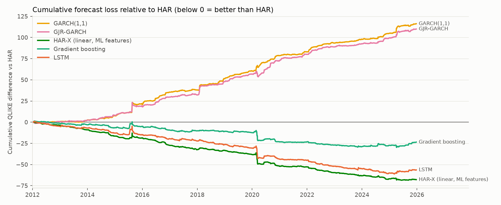
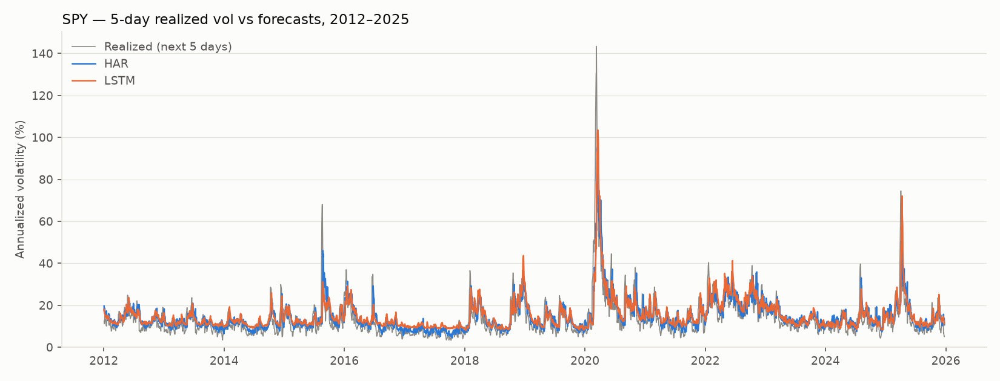

# Machine Learning for Volatility Forecasting

In this project I try to forecast the realized volatility of S&P 500 stocks over the next
5 trading days. I compare classic econometric models (HAR, GARCH) with gradient boosting and
an LSTM, using a walk-forward test over 2012-2025, and then check whether better forecasts
actually help a volatility-targeting strategy on SPY.

## What I found

The short version: machine learning does beat the standard HAR benchmark, but a plain
linear regression fed with the same inputs does just as well.

On the QLIKE loss, the LSTM is 5.8% better than HAR, and the difference is clearly
significant (Diebold-Mariano p < 0.001). Gradient boosting is 2.4% better, which is not
significant at 5% (p = 0.069). I then ran a linear model on the same 15 predictors,
estimated stock by stock (I call it HAR-X). It ended up being the most accurate model of all
(7.0% better than HAR, and better on all 23 stocks), and the LSTM cannot be statistically
told apart from it (p = 0.19). So most of the gain comes from the extra information,
mainly range-based Parkinson volatility, the VIX and overnight variance, rather than from
non-linearity.

A few other results:

- GARCH and GJR-GARCH lose to HAR by 11-12% on QLIKE. At multi-day horizons, and with
  range-based data available, this is what the literature usually finds.
- With MSE as the loss, almost nothing is significant. Squared errors on variance are
  driven by a handful of crisis days.
- Better forecasts did not lead to a better strategy. None of the volatility-targeting
  strategies beats SPY buy-and-hold on Sharpe ratio (0.72 to 0.80 vs 0.82, with a standard
  error around 0.31). They do cut the worst drawdown, from about 21% to about 15% at equal
  volatility, but the most accurate forecasts (HAR-X, LSTM) are not the ones with the best
  Sharpe.

These are mixed results for the "ML vs econometrics" question. I report them as they came
out. No hyperparameter was tuned on the test period.

## Data and target

I use daily OHLCV data from Yahoo Finance (`yfinance`) from January 2005 to December 2025,
adjusted for splits and dividends and cached locally in parquet files (they are not in the
repository). The universe is SPY plus 22 large S&P 500 stocks from 9 sectors: AAPL, MSFT,
INTC, CSCO, GOOGL, AMZN, HD, MCD, PG, KO, WMT, JPM, BAC, GS, XOM, CVX, JNJ, PFE, UNH, CAT, BA
and NEE.

This list has a survivorship bias. I picked stocks that are still large today, so
companies that collapsed or left the index are missing, and the universe is probably calmer
than one built with the information available at each date.

The VIX is used as an extra input, always lagged by one day, since it closes after the stock
market.

For the daily variance I use the Garman-Klass range estimator, to which I add the squared
overnight return:

`v_t = ln(O_t/C_{t-1})² + ½ ln(H_t/L_t)² − (2 ln 2 − 1) ln(C_t/O_t)²`

The overnight term matters more than I expected. It represents 23% (NEE) to 40% (GOOGL) of
total variance, and 35% for SPY. Without it the target would be biased downwards, and a
model estimated on close-to-close returns like GARCH would be penalized for no good reason.

The target is the annualized volatility over the next 5 days,
`RV_t = sqrt(252/5 · Σ_{i=1..5} v_{t+i})`, and the models predict its logarithm. It is only a
proxy: proper realized volatility needs intraday data, for example 5-minute returns.
Patton (2011) shows that QLIKE and MSE still rank models correctly when the proxy is noisy,
which is why I rely on them.

## Models

| Model | Description | Estimation |
|---|---|---|
| Naive | realized vol of the last 5 days | none |
| HAR-RV (Corsi, 2009) | OLS of ln RV on ln rv_d, ln rv_w, ln rv_m (1, 5 and 22 days) | per stock, refit every 21 days |
| GARCH(1,1), GJR-GARCH(1,1) | Student-t innovations, close-to-close returns, sum of the 1- to 5-step variance forecasts | per stock, refit every 21 days, variance updated daily in between |
| HAR-X | OLS of ln RV on the 15 ML predictors | per stock (and pooled, as an ablation), refit every 21 days |
| Gradient boosting | scikit-learn `HistGradientBoostingRegressor` on the 15 predictors | one model for all stocks, refit every 21 days |
| LSTM | 1 layer of 32 units, 22-day sequences of the 15 predictors, averaged over 3 seeds | one model for all stocks, refit every year |

The 15 predictors are: log realized vol over 1, 5 and 22 days; the daily return and its
mean over 5 and 22 days; the absolute return of the day and its 5-day mean; the negative
part of the return; log Parkinson vol over 1 and 5 days; log VIX (lagged) and its 5-day
change; log volume relative to its 22-day mean; and log overnight vol over 5 days.

Since the models work in logs, getting back to variance needs a correction. If
`ln RV = m + ε` with `ε ~ N(0, s²)`, then `E[RV²] = exp(2m + 2s²)`. Using `exp(2m)` alone
would underestimate variance systematically (Jensen's inequality), and QLIKE punishes that
heavily. For the linear models I estimate `s²` on the training residuals. For gradient
boosting and the LSTM, in-sample residuals are far too optimistic, so I use the residuals on
a held-out validation year instead.

## Avoiding look-ahead bias

This was the part I spent the most care on.

The test is an expanding-window walk-forward. At each refit date T, a model is trained on
everything from 2005 up to T and then forecasts the following block, starting on
2012-01-03. Nothing is ever shuffled across time.

Because the target covers days t+1 to t+5, a training sample dated t is only usable once
day t+5 has passed. So at date T I only train on samples with `t ≤ T − 5` (this is
called purging).

Early stopping needed some thought. scikit-learn draws its validation set at random, which
would leak information through the overlapping targets. I replaced it with a time-based
split: the last 252 days of each training window are used for validation, with a 5-day gap
before them. Gradient boosting is then refitted on the whole window with the number of trees
found this way, while the LSTM simply keeps its best epoch. The LSTM scalers are refitted at
each refit on the training data only.

Hyperparameters were chosen once, training on 2005-2008 and validating on 2009-2011, then
frozen in `configs/default.yaml`. The grids were small and the scores very close (QLIKE
from 0.257 to 0.274 for gradient boosting, 0.318 to 0.330 for the LSTM), so this choice has
little impact.

The 60 pytest tests check most of this by perturbing the data: features at t must not move
when later data change, the target at t must only depend on t+1 to t+5, the VIX must enter
with a one-day lag, GARCH forecasts and LSTM training must ignore the future, the splits
must be purged, and the backtest must only trade once the forecast is known. On the real
data, I also retrained one LSTM refit after erasing every target after the training cutoff,
and got exactly the same forecasts.

## How the models are compared

I use four measures, all on the variance scale: QLIKE (the main one), MSE of the variance,
MAE of the volatility, and the Mincer-Zarnowitz regression `RV² = α + β F`. The comparison
uses the 80,845 forecasts where every model is available (23 stocks, from 2012-01-03 to
2025-12-23). Metrics are computed stock by stock and then averaged.

Significance comes from Diebold-Mariano tests with a Newey-West variance and the
Harvey-Leybourne-Newbold small-sample correction. For the whole universe I test the daily
average of the loss differences across stocks, because stocks are strongly correlated and
testing them one by one would overstate significance.

The choice of the Newey-West bandwidth turned out to matter. I first used the usual rule,
`4(n/100)^{2/9}`, which gives about 8 lags. When I simulated loss differences with overlapping
5-day windows and volatility clustering, this rule rejected a true null 20 to 30% of the time
instead of 5%. With `√n` lags (about 59 here), the rejection rate drops to 5-8%, so that is
what I use (see `tests/test_evaluation.py`). For single-year regimes (around 250 days), no
choice of bandwidth is really reliable, and those p-values should only be read as
indications.

## Results

### Forecast accuracy (2012-2025, average over 23 stocks)

| Model | QLIKE | vs HAR | MSE (var.) | MAE (vol) | MZ β | MZ R² | Stocks beating HAR (QLIKE) |
|---|---|---|---|---|---|---|---|
| HAR-X (per stock) | 0.258 | −7.0% | 0.022 | 0.061 | 0.94 | 0.31 | 23/23 |
| LSTM | 0.261 | −5.8% | 0.021 | 0.059 | 1.03 | 0.32 | 19/23 |
| Gradient boosting | 0.271 | −2.4% | 0.020 | 0.062 | 0.92 | 0.31 | 19/23 |
| HAR | 0.277 | | 0.022 | 0.066 | 1.22 | 0.28 | |
| GJR-GARCH | 0.309 | +11.3% | 0.021 | 0.069 | 0.82 | 0.28 | 1/23 |
| GARCH(1,1) | 0.310 | +11.9% | 0.022 | 0.070 | 0.84 | 0.25 | 1/23 |
| Naive | 0.392 | +41.2% | 0.027 | 0.070 | 0.52 | 0.29 | 0/23 |

### Diebold-Mariano tests on QLIKE

Each cell gives the p-value of the universe-level test, then the number of stocks where the
model is significantly better (+) or worse (−) at 5%. With 23 stocks, about one rejection
per row can be expected just by chance.

| Model | vs GARCH | vs HAR | vs HAR-X |
|---|---|---|---|
| HAR-X | p < 0.001 (21+ / 0−) | p < 0.001 (15+ / 0−) | |
| LSTM | p < 0.001 (18+ / 0−) | p < 0.001 (13+ / 0−) | p = 0.185 (2+ / 2−) |
| Gradient boosting | p < 0.001 (17+ / 0−) | p = 0.069 (7+ / 0−) | p < 0.001 (0+ / 11−) |
| HAR | p < 0.001 (15+ / 0−) | | p < 0.001 (0+ / 15−) |
| GJR-GARCH | p = 0.595 (2+ / 1−) | p < 0.001 (0+ / 10−) | p < 0.001 (0+ / 19−) |

On MSE, only the naive model is significantly different from HAR (worse, p = 0.04). For
every other pair the universe-level p-value is above 0.25. The full table is in
`reports/tables/results.md`.

### Where the gains come from

I added a few variants to understand what drives the results:

| Variant | QLIKE vs HAR |
|---|---|
| HAR pooled across stocks | +2.4% |
| Gradient boosting on the 3 HAR inputs only | +1.9% |
| HAR-X pooled (15 inputs) | −1.9% |
| Gradient boosting (15 inputs, pooled) | −2.4% |
| LSTM (15 inputs, pooled) | −5.8% |
| HAR-X per stock (15 inputs) | −7.0% |

Estimating a single HAR for all stocks makes it worse, so pooling by itself does not help.
Gradient boosting with only the HAR inputs is also worse than HAR: trees have trouble
reproducing a relationship that is close to linear. With the full set of inputs, gradient
boosting ends up at the level of a pooled linear model. The LSTM is the best of the pooled
models, but the per-stock linear model still does better.

### By market regime (QLIKE relative to HAR, universe DM p-value)

| Model | 2015-2019 (calm) | 2020 (Covid) | 2022 (inflation) |
|---|---|---|---|
| HAR-X | 0.944 (p < 0.001) | 0.874 (p = 0.19) | 0.853 (p < 0.001) |
| LSTM | 0.955 (p = 0.046) | 0.881 (p = 0.29) | 0.847 (p = 0.001) |
| Gradient boosting | 0.985 (p = 0.41) | 0.900 (p = 0.28) | 0.917 (p = 0.007) |
| GARCH(1,1) | 1.136 (p < 0.001) | 1.164 (p < 0.001) | 1.226 (p = 0.001) |

The models with more inputs gain the most in stressed markets (12 to 15% better than HAR).
For 2020 alone, one year of data is not enough to make the difference significant.

### Figures



Each line adds up a model's loss minus HAR's loss, so a line going down means the model is
doing better than HAR. HAR-X and the LSTM improve steadily, with a jump in March 2020, while
GARCH falls behind year after year.


During the Covid shock, every model reacts a few days late. The linear HAR-X sometimes
overshoots, up to about 175% on SPY, because a linear model extrapolates when its inputs
reach unusual values. QLIKE is much more forgiving of over-prediction than of
under-prediction, which partly explains why HAR-X still scores well.




Permutation importance is measured on the validation year of each refit. The 5-day Parkinson
volatility and the monthly realized volatility dominate. Correlated inputs, like Parkinson
5-day and the weekly realized vol, share their importance, so a low score does not mean a
variable is useless.

## Volatility-targeting backtest on SPY

The strategy holds a weight `w = min(10% / forecast vol, 2)` in SPY. The weight is decided on
the last trading day of each week, using the previous day's forecast, and the trade happens
at that day's close. Between rebalancing dates the position drifts with prices. I use SPY's
total return, cash earns (and leverage costs) the previous day's 13-week T-bill rate
(`^IRX`), and each trade costs 5 basis points of the amount traded. The period runs from
2012-01-06 to 2025-12-19.

Comparing with raw buy-and-hold would not be fair, since it carries much more risk (16.7%
volatility against about 10%). So for each strategy I also report buy-and-hold scaled down to
the same realized volatility, with the same weekly rebalancing and costs. This scaling uses
hindsight, so it is a reference point, not something one could actually trade.

| Strategy | Return | Vol | Sharpe (± s.e.) | Max DD | Turnover / yr | Scaled B&H return | Scaled B&H max DD |
|---|---|---|---|---|---|---|---|
| SPY buy-and-hold | 14.8% | 16.7% | 0.82 (± 0.31) | −33.7% | | | |
| HAR | 9.6% | 10.2% | 0.80 (± 0.31) | −15.6% | 6.7 | 9.8% | −21.7% |
| LSTM | 9.2% | 9.7% | 0.79 (± 0.31) | −14.8% | 4.4 | 9.4% | −20.7% |
| HAR-X | 9.3% | 10.2% | 0.78 (± 0.31) | −15.9% | 6.5 | 9.7% | −21.7% |
| Gradient boosting | 8.6% | 9.3% | 0.77 (± 0.30) | −14.6% | 5.6 | 9.1% | −20.0% |
| GARCH(1,1) | 9.0% | 10.0% | 0.76 (± 0.30) | −14.9% | 5.1 | 9.6% | −21.4% |
| GJR-GARCH | 8.9% | 10.4% | 0.72 (± 0.30) | −15.4% | 6.9 | 9.9% | −22.1% |
| Naive | 9.9% | 11.7% | 0.74 (± 0.30) | −18.4% | 13.0 | 10.9% | −24.6% |


The forecasts do their job as a risk control: every strategy ends up between 9.3% and 10.4%
volatility, close to the 10% target (the naive one overshoots at 11.7%). But none of them
improves on the Sharpe ratio of buy-and-hold. The gaps are at most 0.08, about a quarter of
one standard error, and each strategy also earns slightly less than buy-and-hold scaled to
the same risk.

Where volatility targeting does help is on drawdowns, by about 6 points. The worst loss of
scaled buy-and-hold is the Covid crash (−21.7%, February to March 2020). By the end of
February 2020, the HAR strategy had already cut its weight from 0.81 to 0.30 and missed most
of that fall. Its own worst drawdown (−15.6%) came in 2022, a slow bear market in which
volatility never rose enough to reduce the position much. On the other hand, volatility
spikes were often followed by quick rebounds (2020, 2025), and a portfolio that has just cut
its exposure misses part of them. Over the period, this roughly cancels out the benefit of
avoiding the crashes.

Forecast accuracy does not translate into the strategy ranking. HAR has the best Sharpe
ratio even though it is the least accurate of the HAR-type and ML models. The LSTM trades the
least (4.4 times the portfolio per year), which would matter in practice but does not show
up in the Sharpe ratio.

I also ran an "oracle" strategy that knows next week's realized volatility in advance. It
reaches a Sharpe ratio of 1.93 (see `reports/tables/backtest.csv`), but this is misleading:
the most volatile weeks are mostly falling weeks, so knowing future volatility partly means
knowing future returns. It is not a fair measure of what a perfect forecast is worth.

## Limitations

- The volatility proxy is built from daily prices, not intraday data. Garman-Klass assumes
  continuous prices without drift, and discrete trading and bid-ask bounce distort the
  daily range.
- The stock universe has a survivorship bias, so the results only really apply to large,
  liquid stocks that survived.
- Earnings announcements are not modeled, even though they cause large overnight jumps.
  Three of the four stocks where all models struggle the most (AMZN, INTC, CSCO) are among
  those with the highest overnight share of variance (39-40%). The fourth one, WMT, is not
  (31%). An earnings calendar would probably help, but `yfinance` does not provide a
  reliable one.
- The pooled models (gradient boosting and LSTM) have no stock identifier. Gradient boosting
  does worse than HAR on the big tech names (AAPL, GOOGL, INTC, AMZN).
- I decided to add the HAR-X models after seeing the gradient boosting and LSTM results, but
  before running them, and I did not tune them. They turned out to be the strongest models,
  and I report them as such.
- On the 2009-2011 tuning split, the LSTM was clearly worse than gradient boosting (QLIKE
  0.318 vs 0.257), yet it came out ahead on the test period. It had much less training data
  there (about 20k sequences, against about 100k in the last walk-forward refits). I checked
  this reversal for leakage (see above) but did not try to tune it away.
- Many Diebold-Mariano tests are run, so a few significant results could be due to chance.
  The regime p-values rest on about 250 days, and 14 years is not long enough to separate
  Sharpe ratios this close.
- The backtest is simplified: a single asset, borrowing at the T-bill rate, linear costs, no
  market impact and no margin constraints. The scaled buy-and-hold benchmark uses hindsight.
- `yfinance` is not an official data source, and Yahoo can revise adjusted prices.

## CV summary

- Built an end-to-end walk-forward pipeline (Python, scikit-learn, PyTorch, `arch`) to
  forecast the 5-day realized volatility of 23 S&P 500 stocks over 2012-2025, comparing
  HAR, GARCH, gradient boosting and LSTM models with purged validation, 60 leakage and
  correctness tests, and Diebold-Mariano inference.
- Found that an LSTM reduced the QLIKE loss by 5.8% vs the HAR benchmark (p < 0.001), but a
  linear model on the same predictors did as well (−7.0%). In a SPY volatility-targeting
  backtest, better forecasts did not raise the Sharpe ratio but cut the maximum drawdown
  from 22% to 16% at equal volatility.

## Running it

You need Python 3.12. Everything runs on CPU. I ran it on an 8-core Apple Silicon laptop
with 8 GB of RAM.

```bash
python3.12 -m venv .venv
source .venv/bin/activate
pip install -r requirements-lock.txt
pip install -e .

pytest                        # 60 tests, about 10 seconds
python scripts/run_all.py     # downloads the data and runs everything, about 22 minutes
```

`python scripts/run_all.py --use-cache` reloads the forecasts saved in `results/predictions/`
and only reruns the evaluation and the backtest, which takes about 15 seconds. The scripts
`scripts/tune_gbm.py` and `scripts/tune_lstm.py` redo the hyperparameter selection on
2009-2011; their results are already written in `configs/default.yaml`. Tables go to
`reports/tables/` and figures to `reports/figures/`.

Most of the running time goes into the gradient boosting and LSTM walk-forwards. Seeds are
fixed and PyTorch runs in deterministic mode, so a run from scratch gives exactly the same
tables.

## How I worked

I did this project to keep learning financial econometrics, working with an AI coding
assistant (Claude Code). The rules I set for myself are in [`BRIEF.md`](BRIEF.md) (in
French). I went phase by phase (data, benchmarks, gradient boosting, LSTM, evaluation,
backtest, report), approved a short plan before any code was written, made sure I could
explain every line, kept the test period untouched, and reviewed the key concepts and likely
interview questions at the end of each phase. The git history has one commit per phase.

## Repository layout

```
configs/default.yaml        all settings: universe, dates, horizon, frozen hyperparameters
src/volforecast/
  data.py                   download, cache, cleaning, calendar alignment
  targets.py                Garman-Klass + overnight variance, 5-day target
  features.py               HAR and ML predictors, pooled panel
  walkforward.py            splits, purging, purged hold-out, generic walk-forward loop
  models/                   naive, HAR / HAR-X, GARCH / GJR, gradient boosting, LSTM
  evaluation.py             QLIKE, MSE, MAE, Mincer-Zarnowitz, Diebold-Mariano, regimes
  backtest.py               volatility-targeting engine and performance metrics
  plots.py                  figures
scripts/run_all.py          end-to-end pipeline
scripts/tune_*.py           one-off hyperparameter selection before the test period
tests/                      leakage, correctness and accounting tests
reports/                    tables and figures
```

## References

- Corsi, F. (2009). A simple approximate long-memory model of realized volatility.
  *Journal of Financial Econometrics*.
- Garman, M. & Klass, M. (1980). On the estimation of security price volatilities from
  historical data. *Journal of Business*.
- Patton, A. (2011). Volatility forecast comparison using imperfect volatility proxies.
  *Journal of Econometrics*.
- Diebold, F. & Mariano, R. (1995). Comparing predictive accuracy. *Journal of Business &
  Economic Statistics*.
- Harvey, D., Leybourne, S. & Newbold, P. (1997). Testing the equality of prediction mean
  squared errors. *International Journal of Forecasting*.
- Glosten, L., Jagannathan, R. & Runkle, D. (1993). On the relation between the expected
  value and the volatility of the nominal excess return on stocks. *Journal of Finance*.
- Christensen, K., Siggaard, M. & Veliyev, B. (2023). A machine learning approach to
  volatility forecasting. *Journal of Financial Econometrics*.
- Moreira, A. & Muir, T. (2017). Volatility-managed portfolios. *Journal of Finance*.
- Lo, A. (2002). The statistics of Sharpe ratios. *Financial Analysts Journal*.
- López de Prado, M. (2018). *Advances in Financial Machine Learning*.
